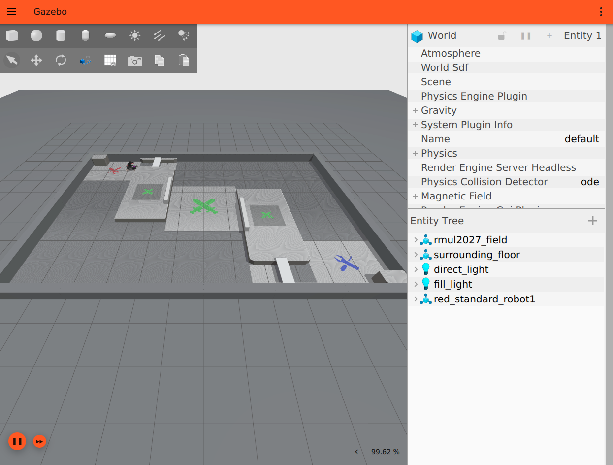

# RMUL2027 哨兵仿真（深北莫 rmu_gazebo_simulator + RMUL2027 3v3 场地）

把 [RMUL2027 3v3 场地](https://github.com/bombomdragon/rmul2027_field) 接进
[深北莫北极熊战队的 rmu_gazebo_simulator](https://github.com/SMBU-PolarBear-Robotics-Team/rmu_gazebo_simulator)
（ROS 2 Humble + Ignition Fortress），打包成开箱即用的 Docker 仿真软件，用于测试哨兵行为树 / 导航。



## 1. 包里有什么

```
rmul2027_sentry_sim/
├── 启动仿真.sh          # 启动仿真（首次会自动构建/导入镜像）
├── 启动导航.sh          # 启动深北莫 pb2025_sentry_nav（Nav2 + point_lio，SLAM 模式）
├── 启动全部.sh          # 仿真 + 导航一起启动
├── 进入终端.sh          # 进入已 source 好 ROS 2 的容器终端
├── 查看日志.sh          # 跟踪容器日志
├── 停止.sh              # 停止所有容器
├── docker/              # 镜像构建上下文：Dockerfile、场地模型、world、launch
│   ├── Dockerfile
│   ├── models/rmul2027_field/
│   ├── worlds/rmul_2027_world.sdf
│   └── config/gz_world.yaml
├── preview/             # Gazebo 截图
├── 行为树说明.md        # Nav2 / 行为树接口与 BT.CPP 编译记录
└── README.md
```

> 仓库不含 2.7 GB 的预构建镜像（GitHub 单文件 100 MB 限制）。
> `./启动仿真.sh` 首次运行会自动用 `docker/` 构建镜像；如果你另外拿到了离线
> `images/*.tar.gz`，放到 `images/` 下会优先直接 `docker load`。

镜像里包含：

| 组件 | 版本 / 说明 |
| --- | --- |
| 基础仿真 | `ghcr.io/smbu-polarbear-robotics-team/rmu_gazebo_simulator:1.0.0` |
| 场地 | RMUL2027 3v3，1:1，12.0 × 8.0 m 可行驶区，原点在场地中心 |
| 物理 | Ignition Fortress / DART，`max_step_size = 0.002`（500 Hz） |
| 机器人 | 深北莫 `pb2025_robot_description` 标准哨兵（麦轮底盘 + 云台 + 发射机构） |
| 裁判系统 | `simple_competition_1v1.py`（血量、弹丸、RFID、占领/攻击信息） |

## 2. 环境要求

- Linux + Docker（`docker --version` 能正常输出）
- X11 显示（本机桌面，或 `ssh -X` / XWayland；`DISPLAY` 已设置）
- 可选：NVIDIA 显卡 + `nvidia-container-toolkit`，脚本会自动检测并使用 GPU；
  没有 GPU 也能跑，只是帧率低（会退回 Mesa llvmpipe 软件渲染）
- 不需要在宿主机安装 ROS 2、Ignition 或 Gazebo

> 如果 `docker` 命令需要 sudo，脚本会自动改用 `sudo docker`（会提示输入密码）。

## 3. 快速开始

```bash
git clone https://github.com/bombomdragon/rmul2027_sentry_sim.git
cd rmul2027_sentry_sim
chmod +x *.sh          # 如果 clone 后没有执行权限

./启动仿真.sh           # 首次运行会拉基础镜像并构建（约 2~3 分钟）
```

想跳过构建、直接用离线镜像：把 `rmul2027_sentry_sim_image.tar.gz` 放进
`images/` 再运行 `./启动仿真.sh` 即可。

几秒后 Gazebo 窗口出现，机器人位于红方出生点，脚本会自动
`START_SELF_CHECKING` → `START_GAME`，无需再点网页裁判端。

想连导航一起跑：

```bash
./启动全部.sh           # 仿真 + 导航（首次会拉取/导入导航镜像）
# 或已经启动仿真后：
./启动导航.sh
# 需要 RViz：RVIZ=true ./启动导航.sh
```

停止：

```bash
./停止.sh
```

## 4. 场地与坐标

| 项 | 值 |
| --- | --- |
| 可行驶区 | 12.0 m (X) × 8.0 m (Y) |
| 外框（含围墙） | 12.6 m × 8.6 m |
| 原点 | 场地中心，Z 轴向上，地面 z = 0 |
| 红方 | −X 侧；出生点 `(-4.6, 3.1, yaw=0)` |
| 蓝方 | +X 侧（默认未放机器人） |
| 红方补给区 | 约 `(-4.75, 3.0)` |
| 高地 | `x ≈ ±2.5` 附近的 2 × 4 m 区域 |

场地是静态结构（地面、围墙、高地、隧道、工作台），不含能量机关、飞镖、装甲板等动态道具。
碰撞体为 35 个盒体，视觉网格来自原 Blender 文件转换的 DAE。

## 5. 机器人接口

命名空间：`/red_standard_robot1`

### 5.1 控制

| 话题 | 类型 | 说明 |
| --- | --- | --- |
| `/red_standard_robot1/cmd_vel` | `geometry_msgs/msg/Twist` | 底盘速度（最常用） |
| `/red_standard_robot1/robot_base/chassis_cmd` | `rmoss_interfaces/msg/ChassisCmd` | 底层麦轮速度 |
| `/red_standard_robot1/robot_base/gimbal_cmd` | `rmoss_interfaces/msg/GimbalCmd` | 云台角度 |
| `/red_standard_robot1/robot_base/shoot_cmd` | `rmoss_interfaces/msg/ShootCmd` | 发射 |

例：

```bash
docker exec -it rmul2027_sim bash -lc '
  source /opt/ros/humble/setup.bash; source /root/ros_ws/install/setup.bash
  ros2 topic pub -r 20 /red_standard_robot1/cmd_vel geometry_msgs/msg/Twist "{linear: {x: 0.8}}"
'
```

### 5.2 传感器

| 话题 | 类型 | 频率（GPU） |
| --- | --- | --- |
| `/red_standard_robot1/rplidar_a2/scan` | `sensor_msgs/msg/LaserScan` | 10 Hz |
| `/red_standard_robot1/livox/lidar` | `sensor_msgs/msg/PointCloud2` | 20 Hz |
| `/red_standard_robot1/livox/imu` | `sensor_msgs/msg/Imu` | 200 Hz |
| `/red_standard_robot1/front_industrial_camera/image` | `sensor_msgs/msg/Image` | 30 Hz，1920×1080 |
| `/red_standard_robot1/chassis_odometry_gt` | `nav_msgs/msg/Odometry` | 50 Hz，仿真真值 |
| `/red_standard_robot1/joint_states` | `sensor_msgs/msg/JointState` | — |
| `/red_standard_robot1/tf`, `/tf_static` | `tf2_msgs/msg/TFMessage` | — |

TF 树：`odom → chassis → gimbal_yaw → gimbal_pitch → ...`，以及各传感器 frame。
注意 TF 话题是带命名空间的 `/red_standard_robot1/tf`。

### 5.3 裁判系统

| 话题 | 类型 | 说明 |
| --- | --- | --- |
| `/referee_system/referee_cmd` | `rmoss_interfaces/msg/RefereeCmd` | 0 准备 / 1 自检 / 2 开始 / 3 停止 / 4 击杀 / 5 复活 |
| `/referee_system/red_standard_robot1/robot_status` | `rmoss_interfaces/msg/RobotStatus` | 血量、弹丸、位姿 |
| `/referee_system/red_standard_robot1/enable_power` | `std_msgs/msg/Bool` | 电源使能 |
| `/referee_system/red_standard_robot1/enable_control` | `std_msgs/msg/Bool` | 控制使能 |
| `/referee_system/attack_info` | `std_msgs/msg/String` | 被击打信息 |
| `/referee_system/shoot_info` | `std_msgs/msg/String` | 发射信息 |
| `/referee_system/rfid_info` | `rmoss_interfaces/msg/RfidStatusArray` | RFID 状态 |
| `/referee_system/pose_info` | `tf2_msgs/msg/TFMessage` | 机器人真值位姿 |
| `/referee_system/set_pose` | `geometry_msgs/msg/TransformStamped` | 重置机器人位姿 |

## 6. 测试哨兵行为树

### 6.1 只用仿真

如果行为树直接输出 `/red_standard_robot1/cmd_vel`，运行 `./启动仿真.sh` 即可；
在容器里运行你的行为树：

```bash
./进入终端.sh
# 把你的工作空间挂进容器，或直接在里面编译
ros2 run your_bt_package your_bt_node
```

也可以在启动时把工作空间挂进容器（改成自己的路径）：

```bash
docker run -it --rm --name rmul2027_sim --network host --ipc=host \
  --gpus all -e NVIDIA_DRIVER_CAPABILITIES=all \
  -e DISPLAY=$DISPLAY -v /tmp/.X11-unix:/tmp/.X11-unix \
  -v ~/ros_ws/src:/root/ros_ws/src/user_ws:ro \
  rmul2027_sentry_sim:1.0
```

### 6.2 接 Nav2（推荐）

`./启动导航.sh` 会启动深北莫 `pb2025_sentry_nav`：

- Nav2 action：`/red_standard_robot1/navigate_to_pose`（`nav2_msgs/action/NavigateToPose`）
- 地图：`/red_standard_robot1/map`
- 代价地图：`/red_standard_robot1/global_costmap/costmap`、`local_costmap/costmap`
- 定位：`point_lio` + `slam_toolbox`（SLAM 模式，不需要先验点云；先让机器人动起来建图）

行为树里发目标点即可，例如（在容器里）：

```bash
ros2 action send_goal /red_standard_robot1/navigate_to_pose \
  nav2_msgs/action/NavigateToPose \
  "{pose: {header: {frame_id: map}, pose: {position: {x: 2.0, y: 0.0}, orientation: {w: 1.0}}}}"
```

### 6.3 与深北莫 `pb2025_sentry_behavior` 的接口差异

深北莫的行为树默认接实车裁判系统 `pb_rm_interfaces` 和视觉 `auto_aim_interfaces/Target`，
本仿真输出的是 `rmoss_interfaces`（仿真裁判系统）。直接跑会收不到比赛状态 / 目标。
两种做法：

1. 在行为树里把订阅改成 `rmoss_interfaces` 的 `/referee_system/...`；
2. 写一个小桥接节点，把 `rmoss_interfaces/RobotStatus` 转成 `pb_rm_interfaces/RobotStatus`，
   并给 `Target` 喂一个假目标（或接视觉仿真）。

导航部分（`CalculateAttackPose` 用的全局代价地图、`NavigateToPose`）本仿真已具备。
更详细的接口对照、SLAM 地图坐标系注意事项和**实测可用的编译步骤**见
[行为树说明.md](行为树说明.md)。

## 7. 修改与二次开发

镜像内源码在 `/root/ros_ws/src/rmu_gazebo_simulator`，已用 `colcon build` 装到
`/root/ros_ws/install`。改完资源后重新编译：

```bash
./进入终端.sh
cd /root/ros_ws
colcon build --packages-select rmu_gazebo_simulator
```

- 世界文件：`rmu_gazebo_simulator/resource/worlds/rmul_2027_world.sdf`
- 场地模型：`rmu_gazebo_simulator/resource/models/rmul2027_field/`
- 出生点/比赛配置：`rmu_gazebo_simulator/config/gz_world.yaml`
- 一键开始比赛：`rmu_gazebo_simulator/launch/bringup_rmul2027.launch.py`

重新打镜像（在 `rm2027_sentry_sim/pkg` 构建目录）：

```bash
docker build -t rmul2027_sentry_sim:1.0 .
docker save rmul2027_sentry_sim:1.0 | pigz -1 > images/rmul2027_sentry_sim_image.tar.gz
```

## 8. 已知限制

- 场地是静态的：没有能量机关、飞镖、装甲板、弹丸命中判定（裁判系统只按 `shoot_info` 扣弹丸）。
- 裁判系统只有简化 1v1；蓝方机器人默认注释掉，需要自己取消注释并配桥接。
- 场地视觉以灰色 PVC 为主，只有地面标识有颜色（原 Blender 文件就是这样）。
- 软件渲染时帧率明显下降；建议装 `nvidia-container-toolkit` 用 GPU。
- 导航 SLAM 模式的地图会随运动漂移，适合行为树联调，不适合精度评估；需要稳定定位时
  可以给 `pb2025_sentry_nav` 准备 2027 场地的先验 `.pcd` + `.yaml`。

## 9. 出处与许可

- 仿真器：SMBU-PolarBear-Robotics-Team / `rmu_gazebo_simulator`（Apache-2.0）
- 导航：SMBU-PolarBear-Robotics-Team / `pb2025_sentry_nav`（Apache-2.0）
- 场地：`bombomdragon/rmul2027_field`。场地设计版权归原始设计方所有；仓库只包含由
  原始 Blender 文件转换的 Gazebo 资源，商用/再分发前请确认原始场地授权。
